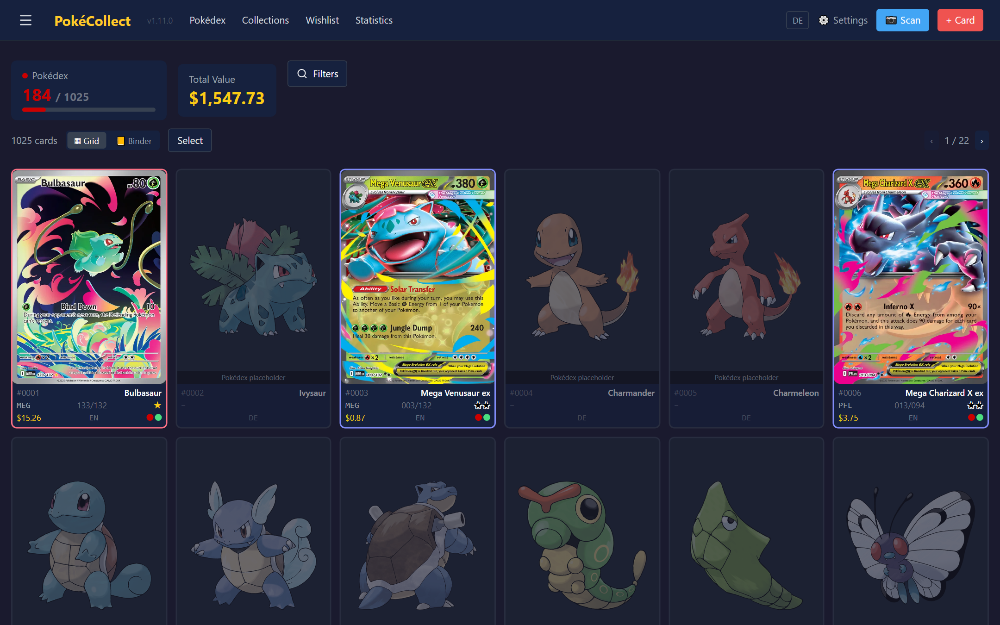
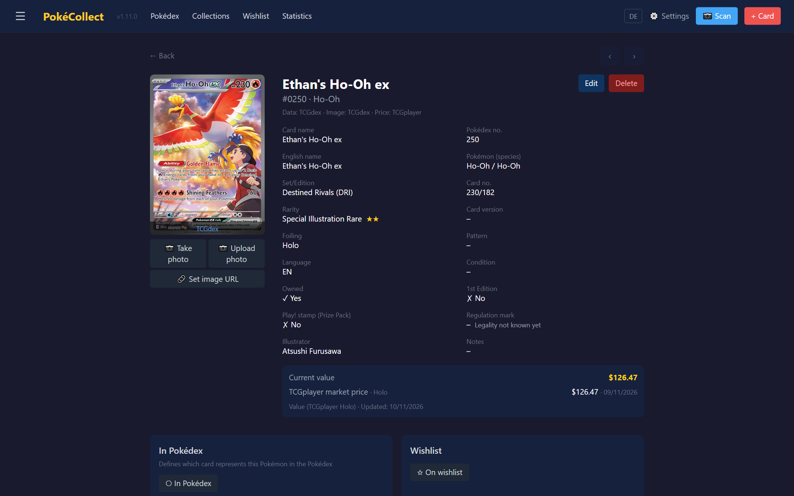
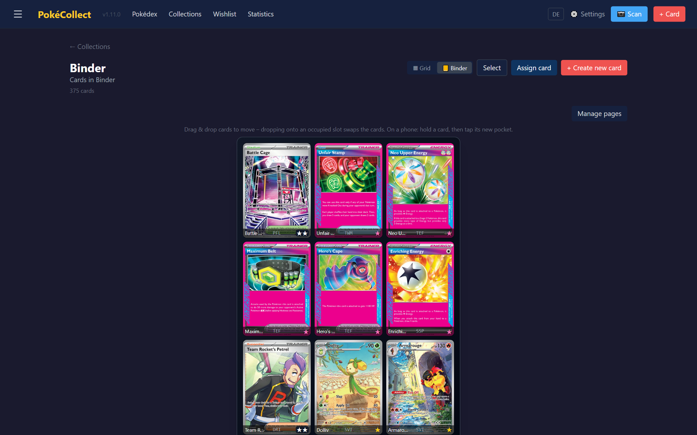
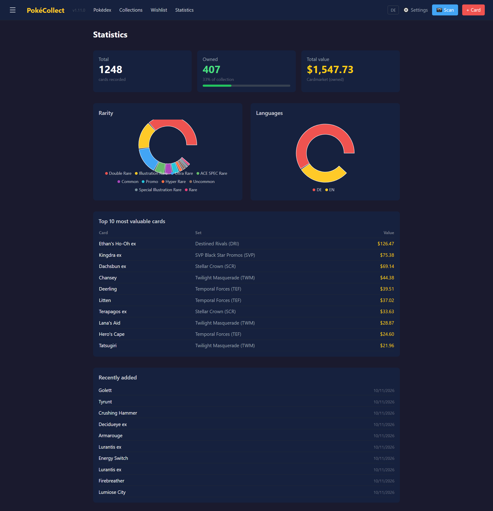
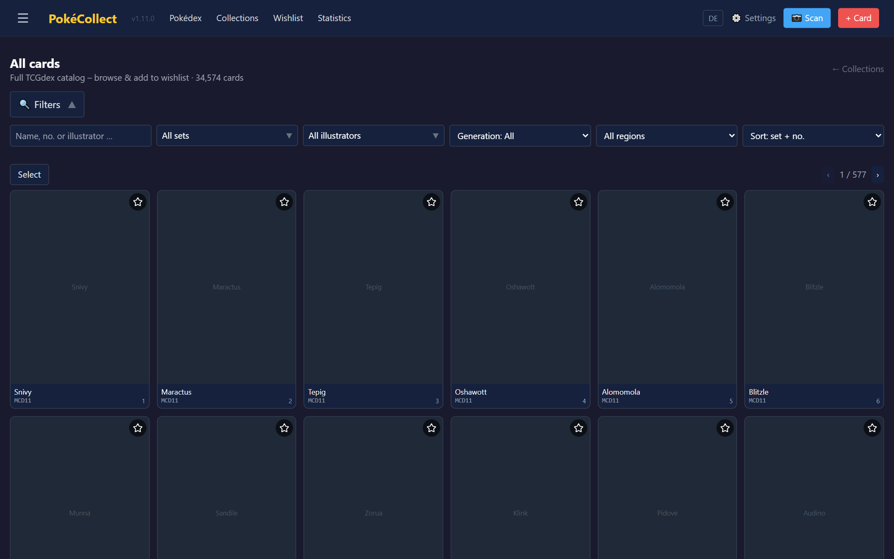
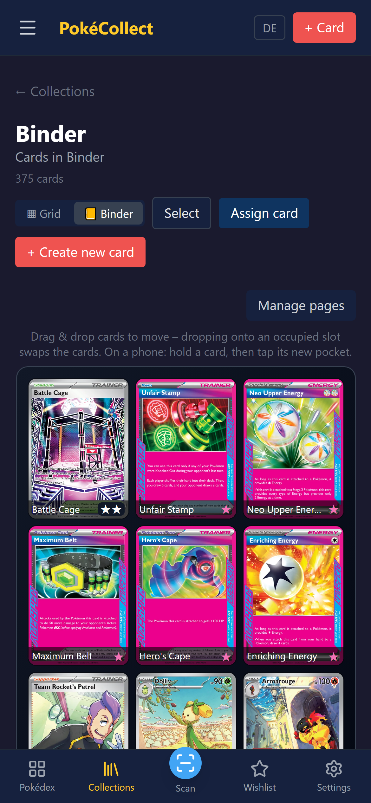
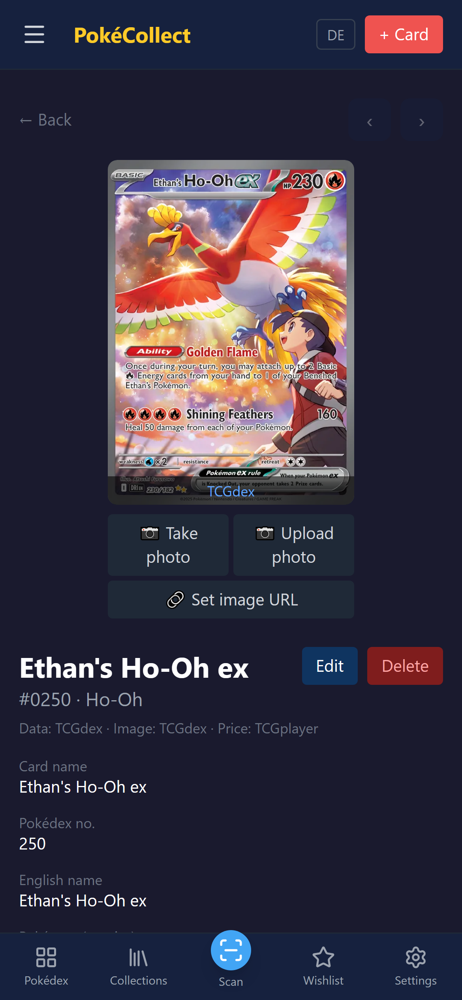

# PokéCollect

A free, self-hosted Pokémon TCG collection tracker. Track your physical cards in a Pokédex-style grid or page-flip binder, scan new cards with your phone camera (local image matching, local OCR or a cloud vision model), browse the full TCGdex catalog, and keep all data on your own hardware — no subscription, no cloud, no third-party account required.

This is the **`english` branch of [Circuitrinos/pokecollect](https://github.com/Circuitrinos/pokecollect/tree/english)**, a fork of [Trust1509/pokecollect](https://github.com/Trust1509/pokecollect). On top of the original it adds an English-first interface, USD prices, multiple users with single sign-on, a local image-matching card scanner, and the binder, scanning and tournament-legality features listed below.

> **Version history: see the [Changelog](CHANGELOG.md)** (upstream releases) · [Roadmap →](ROADMAP.md)

---

## Screenshots

| Pokédex | Card detail |
|---|---|
|  |  |

| Binder | Statistics |
|---|---|
|  |  |

| Catalog | On a phone |
|---|---|
|  |   |

The screenshots are made with `e2e/screenshots.mjs` (see [Updating the screenshots](#updating-the-screenshots)).

## Features

### Collection
- **Pokédex view** — all 1025 Pokémon as a grid or binder; owned cards fill their slot, missing ones show the official artwork as a placeholder. One representative card per species ("In Pokédex" flag).
- **Collections** — any number of your own binders/collections, each with its own layout and slot order. A collection can also be a **set goal** (a set, optionally the master set with secret rares) that shows what's still missing.
- **Binder view** — configurable page layout (1×1 … 4×4), pages sized to fit phone screens, swipe to flip pages. Filters dim non-matching cards instead of removing them, so every card keeps its place.
- **Organizing** — drag & drop on desktop; on touch screens hold a card to pick it up and tap where it should go. The page manager has a *Move cards* mode for moving cards across the whole binder and can reorder pages.
- **Grid or binder per collection**, remembered on the server (same view on every device). The grid can be sorted by name, Pokédex number, set, value or date added, and a sort can be applied as the binder order.
- **Bulk selection** in grid and binder view: switch between catalog image and own photo, set Prize Pack stamp or condition, add to/remove from a collection, delete.
- **Card details** — foiling and pattern (Poké Ball, Master Ball, …), condition, 1st Edition, Play! Pokémon **Prize Pack** stamp, purchase price and date with unrealized gain/loss, price history chart.
- **Tournament legality** — each card's **regulation mark** (from TCGdex) with its Standard status: a badge on every card, *Standard format* and *Regulation mark* filters. The lowest legal mark is a setting (default **H** for 2026-27). Basic Energy is always legal; an older Trainer or Special Energy counts as legal only when a card with the same name **and the same text** has a legal mark — same name with different text is flagged for checking by hand.
- **Wishlist** with priorities (Chase/High/Medium/Low) and **sealed products** (booster, display, ETB, tin, …) with values.
- **Catalog** — local mirror of the TCGdex card database (western and Japanese sets), searchable by name/number/illustrator, filterable by set/generation; one click adds a card to the wishlist or a collection.

### Card scanning
- **Readers** (chosen in Settings):
  - **Image match (local, no cloud)** — the `matcher` service recognizes the card by its artwork (OpenCV ORB + RANSAC, optional DINOv2 shortlist), reads the collector number with Tesseract to tell reprints apart, and lets you pick when it isn't sure.
  - **Cloud vision models** — Google Gemini, OpenAI or OpenRouter (API key in Settings), with daily usage tracking for Gemini.
  - **Local OCR only** — Tesseract, no cloud.
- **Three modes:** single card, several loose cards, a full binder page.
- **Camera:** card-shaped guide, auto-capture when a card is held steady, live outlines of every detected card in multi-card and binder mode.
- **Back-to-back scanning** — *Confirm & continue* keeps the camera running; *Confirm & stop* returns to the page you came from. Scanning from a collection adds to that collection.
- **Review** — every read is matched against TCGdex (set + printed number, name fallback) with confidence scores; add several copies at once; moving the card corners re-runs the match.
- **Pictures** — after a match the card shows the clean catalog image and your photo is kept in the background (or shown instead, if you prefer). Confirmed scan photos help the image matcher recognize your cards next time; admins can export them as a dataset.
- **Photo pipeline:** EXIF normalization, perspective correction, 4-corner editor with magnifier, rotate/flip; the original photo is kept for re-cropping.

### Data & prices
- **TCGdex as the main data source** — card data, images and Cardmarket prices, free and without an API key.
- **EUR or USD** per instance: in USD mode card values come from TCGplayer (Japanese cards via TCGCSV), otherwise from Cardmarket (30-day average or daily price).
- **Daily jobs** — price refresh (hour configurable) plus catalog sync, enrichment, price re-check, regulation marks and the optional local catalog image cache.
- **Card images through your own server** — images and placeholders of your cards are fetched and cached by the API, so the browser doesn't talk to the image hosts for them (the catalog and scan pages still load images directly).
- **Export & backup** — CSV export of your cards; full backup/restore of the instance (admins).

### Users
- **Multiple users**, each with their own cards, collections, wishlist and personal settings; admins manage users and instance settings.
- **Single sign-on via OpenID Connect** (e.g. Authentik), with the local password login as a fallback that can be turned off.

### UI
- **Mobile-first + PWA** — bottom navigation, installable, offline read access via service worker (HTTPS required for install/camera).
- **English and German** — follows the browser language, switchable in the navbar and on the login page; card and set names follow the language.
- **Official rarity symbols** (●◆★ …, PROMO star) for western cards, text codes (C/U/R/RR/SR/AR …) for JP/CN.
- **Consistent filters** across Pokédex, owned cards and catalog: search, status, 1st Edition, Prize Pack, Standard format, regulation mark, generation, set (grouped by series, with logos), rarity, language, illustrator, image status, sort.
- **Statistics** — totals, cost basis and gain/loss, rarity/language breakdown, top 10 by value, recently added, sealed products.
- **"What's new" box** after updates.

---

## Architecture

```
                     ┌──► web (Next.js 15)
browser ──► gateway ─┤
            (:3011)  └──► api (FastAPI) ──► PostgreSQL 16
                           │   ├──► TCGdex (cards, images, prices), TCGCSV (TCGplayer prices)
                           │   ├──► Gemini / OpenAI / OpenRouter (optional scan readers)
                           │   └──► OIDC provider, e.g. Authentik (optional)
                           └──► matcher (image matching; reads the catalog from PostgreSQL)
```

- **Backend** `backend/` — FastAPI + SQLAlchemy. The schema is created automatically on startup (`create_all` + idempotent light migrations in `app/main.py`); no Alembic.
- **Frontend** `web/` — Next.js 15 App Router, Tailwind CSS, Axios. `NEXT_PUBLIC_API_URL` and `NEXT_PUBLIC_CURRENCY` are baked in at **build time**. With an empty API URL the browser calls `/api` on its own origin, which the gateway forwards.
- **Matcher** `matcher/` — optional service for the *Image match* reader; see [matcher/README.md](matcher/README.md).
- **Gateway** — a small reverse proxy (Caddy) that sends `/api/*`, `/images/*`, `/bild-spiegel/*`, `/health`, `/docs` and `/openapi.json` to the api and everything else to web. Without it, the browser needs the api's own address in `NEXT_PUBLIC_API_URL`.
- **Images** — card images from TCGdex/TCGplayer/pokemon.com are fetched by the API (`/bild-spiegel`: signed paths, no redirects followed, fixed hosts) and served like own photos, which come from the API's `/images` mount. The web image optimizer (`next/image`) only accepts the API's own origin.
- **Auth** — every API route (except login, `/health`, `/images` and the signed `/bild-spiegel` paths) requires a JWT. There is no built-in default password: the API refuses to start without `APP_PASSWORD_HASH` (or a hash set in the app). External access can additionally be protected by a reverse-proxy login (see [deploy/README.md](deploy/README.md)).

---

## Quick Start

### Prebuilt images (recommended)

Every push to the `english` branch builds `ghcr.io/circuitrinos/pokecollect-{api,web,matcher}:latest`, plus a `sha-<commit>` tag for rollbacks ([.github/workflows/images.yml](.github/workflows/images.yml)). The web image is built for USD and for relative `/api` calls through the gateway.

[deploy/docker-compose.ghcr.yml](deploy/docker-compose.ghcr.yml) runs api, web, matcher, PostgreSQL and a Caddy gateway on port 3011. Replace the `CHANGE_…` values and the volume paths, then:

```bash
docker compose -f deploy/docker-compose.ghcr.yml up -d
```

On TrueNAS SCALE paste the same file into *Apps → Discover Apps → Custom App → Install via YAML*; with `pull_policy: always` every redeploy picks up the newest images.

### Build from source

```bash
git clone -b english https://github.com/Circuitrinos/pokecollect.git
cd pokecollect
cp .env.example .env
# Edit .env — set POSTGRES_PASSWORD, JWT_SECRET, APP_PASSWORD_HASH, NEXT_PUBLIC_API_URL
docker compose up --build
```

- **Web frontend:** `http://localhost:3011`
- **API + Swagger UI:** `http://localhost:3010/docs`
- **Health/version:** `http://localhost:3010/health`

`docker-compose.yml` builds api, web and db only, and web calls the api on port 3010. For the *Image match* reader add the `matcher` service from the GHCR compose file (with `build: ./matcher`); for a USD instance set `CURRENCY=USD` on the api and the build argument `NEXT_PUBLIC_CURRENCY=USD` on web.

---

## Configuration

| Variable | Service | Required | Description |
|----------|---------|----------|-------------|
| `POSTGRES_PASSWORD` | db | ✅ | Database password |
| `DATABASE_URL` | api, matcher | ✅ | e.g. `postgresql://pokecollect:<password>@db:5432/pokecollect` |
| `JWT_SECRET` | api | ✅ | Random string for JWT signing (min. 32 chars) |
| `APP_PASSWORD_HASH` | api | ✅ | bcrypt hash of the primary admin's password — the API refuses to start without it (generation: see `.env.example`) |
| `APP_USERNAME` | api | ➖ | Primary admin's username (default `admin`) |
| `CURRENCY` | api | ➖ | `EUR` (default) or `USD` — the currency card values and purchase prices are stored in |
| `CATALOG_IMAGE_LANG` | api | ➖ | Language of catalog card images: `de` (default) or `en` |
| `CORS_ORIGINS` | api | ➖ | Comma-separated browser origins when web and api run on different origins. Empty = `http://localhost:3011,http://localhost:3021` |
| `MATCHER_URL` | api | ➖ | Address of the image matcher (default `http://matcher:8000`) |
| `GEMINI_API_KEY` | api | ➖ | Gemini scan reader; this and the OpenAI/OpenRouter keys can also be set in Settings |
| `CARDMARKET_*` | api | ➖ | Cardmarket OAuth 1.0a — optional price fallback only |
| `OIDC_ISSUER`, `OIDC_CLIENT_ID`, `OIDC_CLIENT_SECRET` | api | ➖ | Single sign-on, active when issuer and client id are set. Authentik issuer: `https://<authentik>/application/o/<app-slug>/` |
| `PUBLIC_URL` | api | ➖ | Public base URL of the app. The OIDC redirect URI is `PUBLIC_URL/api/v1/auth/oidc/callback` (or set `OIDC_REDIRECT_URI`) |
| `OIDC_ALLOWED_ORIGINS` | api | ➖ | Further origins a login may return to, e.g. the LAN address |
| `OIDC_PROVIDER_NAME` | api | ➖ | Label of the SSO button (default `Authentik`) |
| `OIDC_ADMIN_USERS` | api | ➖ | SSO usernames/e-mails that become admin; the first of them to sign in takes over the primary admin's collection (default: `APP_USERNAME`) |
| `OIDC_ADMIN_GROUP` | api | ➖ | Members of this provider group become admin too |
| `OIDC_AUTO_CREATE` | api | ➖ | `false` = only already-known users may sign in (default `true`) |
| `PASSWORD_LOGIN` | api | ➖ | `false` hides the local password login (default `true`) |
| `REGULATION_BACKFILL_ON_START` | api | ➖ | Fetch missing regulation marks shortly after start (default `true`) |
| `NEXT_PUBLIC_API_URL` | web (build) | ➖ | URL the **browser** uses to reach the API. Empty = same origin through the gateway. Rebuild the web image after changing it. |
| `NEXT_PUBLIC_CURRENCY` | web (build) | ➖ | `EUR` (default) or `USD`; must match `CURRENCY` |

The matcher has its own settings (index refresh, DINOv2 shortlist, learning from scans): see [matcher/README.md](matcher/README.md). TCGdex needs **no key**.

---

## Server Deployment

- **Any Docker host or TrueNAS SCALE with the prebuilt images:** see [Prebuilt images](#prebuilt-images-recommended).
- **Building on the server (TrueNAS / Portainer):** [deploy/README.md](deploy/README.md) covers ZFS datasets with POSIX ACLs, the Portainer stack, a Caddy reverse proxy and external access via Authelia (written for the original project, in German). Updates: `bash deploy.sh` (git pull → rebuild api+web → restart).

| Service | Port |
|---------|------|
| Gateway (prebuilt images) | 3011 |
| API (build from source) | 3010 |
| Web (build from source) | 3011 |
| Authelia (optional) | 9091 |

---

## Updating the screenshots

`e2e/screenshots.mjs` logs in to a running instance, switches the UI to English and writes the images into `docs/screenshots/`. It doesn't change any data; a collection that isn't in binder view is switched for the shot and switched back.

```bash
cd e2e
npm ci
npx playwright install chromium
PC_URL=https://tcg.example.com PC_USER=admin node screenshots.mjs
```

It asks for the password (or takes `PC_PASSWORD`, or a login token as `PC_TOKEN`). `PC_COLLECTION` picks the collection for the binder shots and `PC_CARD` the card for the detail shots; by default it takes the collection with the most cards and the most valuable owned card with a picture.

---

## Tech Stack

| Layer | Technology |
|-------|-----------|
| Backend | Python 3.12, FastAPI, SQLAlchemy 2, PostgreSQL 16, APScheduler |
| Frontend | Next.js 15, React 19, TypeScript, Tailwind CSS, PWA |
| Scan | OpenCV, ONNX Runtime (DINOv2), Tesseract OCR, Pillow, canvas homography; optional Gemini / OpenAI / OpenRouter |
| Data | TCGdex API (cards, images, Cardmarket prices), TCGCSV (TCGplayer prices) |
| Auth | JWT, OpenID Connect (e.g. Authentik) |
| Deployment | Docker Compose, GitHub Actions → GHCR, Caddy, TrueNAS SCALE / Portainer |

---

## License

MIT

## Support

PokéCollect was created by [Trust1509](https://github.com/Trust1509/pokecollect). If it helps you, consider [buying them a coffee](https://buymeacoffee.com/trust1509) to support continued development.

[](https://buymeacoffee.com/trust1509)
